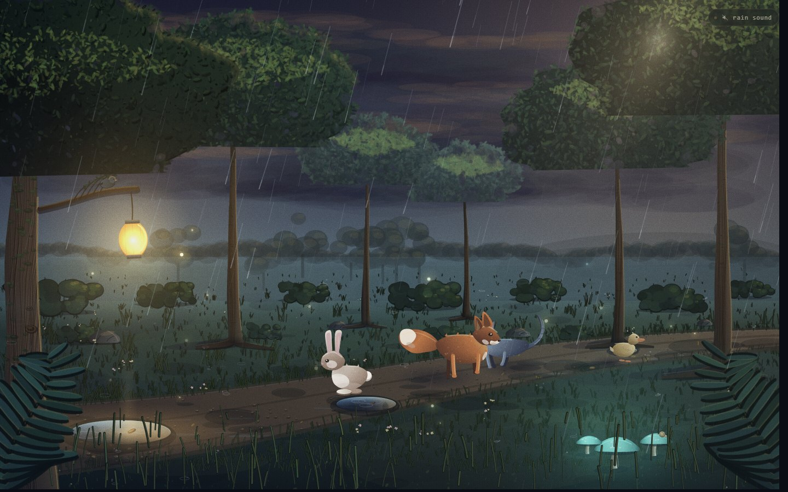

# Rainy Lantern Glade

A single-file, procedurally drawn rainy forest scene. No build step, no dependencies, no image assets.

## What's in it

- Four critters (fox, bunny, cat, duckling) walking a wet path, with turnarounds, pauses, blinks, and tail and ear motion.
- Swaying canopies, bark grooves, moss, roots, and layered foliage.
- Rain with parallax layers, ground splashes, puddle ripples, and drifting mist.
- A swinging paper lantern, glowing mushrooms, a bird on the branch, a snail, and drifting spores.
- Procedural rain audio: pink-noise rain sheets, a fine hiss, leaf patter, droplet plinks, slow gusts, distant thunder, and occasional water footsteps in the puddles.

## Run it

Open `index.html` in a browser. That's it.

Click the **rain sound** pill in the top right to start the audio. Browsers require a user gesture before audio can play. The volume slider next to it starts at 30% and goes up to the full mix. Click a puddle to make ripples.

## Notes

- Canvas 2D, no libraries.
- Every surface gets layered shadow, texture, and rim passes; shadows are hue-shifted cool against a warm upper-right key light.
- Audio is synthesized at runtime with Web Audio, no audio files.
- Tested in Chrome at 1440x900 and 1024x768.

## License

No license has been added yet. Add one if you want others to reuse it.
